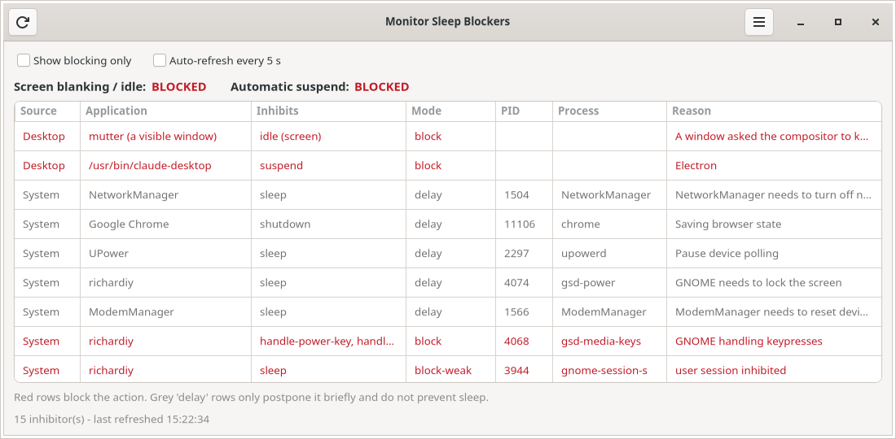

# Monitor Sleep Blockers (Linux)


A small GTK desktop app **for Linux** that shows which applications are
preventing your computer from going to sleep or turning off the screen. It is
the Linux counterpart of `powercfg /requests` on Windows, with a window and a
**Refresh** button.

> **Linux only.** This tool uses systemd-logind and the GNOME Session Manager
> over D-Bus. It does not work on Windows or macOS.



## Features

- Lists desktop inhibitors from the **GNOME Session Manager**: apps that stop
  idle sleep or screen blanking, such as browsers, video players and Electron
  apps.
- Lists system inhibitors from **systemd-logind**: sleep, shutdown and
  power-key locks held by services, with process ID and process name.
- Shows at a glance whether screen blanking and automatic suspend are
  currently blocked.
- Highlights rows that actually **block** an action in red. "Delay" locks,
  which only postpone sleep for a moment, are shown in grey.
- "Show blocking only" filter and optional 5-second auto-refresh.
- Keyboard shortcuts: **F5** or **Ctrl+R** to refresh, **Ctrl+Q** to quit.
- Native GTK 4 look, with an app icon and an app-menu entry.

## Requirements

- A Linux distribution with systemd, for example Ubuntu, Debian, Fedora or
  Arch Linux
- Python 3.9 or newer
- PyGObject and GTK 4 (already installed on most GNOME desktops)
- GNOME, for the desktop inhibitor list (the system list works on any desktop)

Tested on Ubuntu 26.04 with GNOME on Wayland.

If PyGObject or GTK 4 is missing, install it with your package manager:

```bash
# Debian / Ubuntu
sudo apt install python3-gi gir1.2-gtk-4.0

# Fedora
sudo dnf install python3-gobject gtk4

# Arch Linux
sudo pacman -S python-gobject gtk4
```

## Installation

```bash
git clone https://github.com/richardyusan/monitor-sleep-blockers.git
cd monitor-sleep-blockers
./install.sh
```

This installs the app for the current user under `~/.local`. Afterwards,
open **Monitor Sleep Blockers** from your app menu, or run
`monitor-sleep-blockers` in a terminal.

To install for all users instead:

```bash
sudo ./install.sh /usr/local
```

To remove it again:

```bash
./uninstall.sh
```

You can also run it straight from the source folder without installing:

```bash
python3 monitor_sleep_blockers.py
```

## Understanding the results

| Column      | Meaning                                                        |
|-------------|----------------------------------------------------------------|
| Source      | `Desktop` (GNOME session) or `System` (systemd-logind)         |
| Application | Name the application registered the lock under                 |
| Inhibits    | What is being held off: idle, suspend, sleep, shutdown, keys   |
| Mode        | `block` prevents the action; `delay` only postpones it briefly |
| PID/Process | The process holding the lock (system locks only)               |
| Reason      | The explanation given by the application                       |

### "mutter (a visible window)"

On Wayland, an application can ask the compositor directly to keep the screen
on, for example while playing a video or running a video call. GNOME reports
this only as `mutter / idle-inhibit` and does not say which application asked.
To find it, minimize your windows one at a time and press **Refresh**. When the
row disappears, the last window you minimized is the one keeping the screen
awake.

## Command-line equivalents

```bash
# System-level locks
systemd-inhibit --list

# Is idle (screen blanking) inhibited in GNOME? (true/false)
gdbus call --session --dest org.gnome.SessionManager \
  --object-path /org/gnome/SessionManager \
  --method org.gnome.SessionManager.IsInhibited 8
```

## License

Released under the [MIT License](LICENSE). Copyright (c) 2026 richardyusan.
